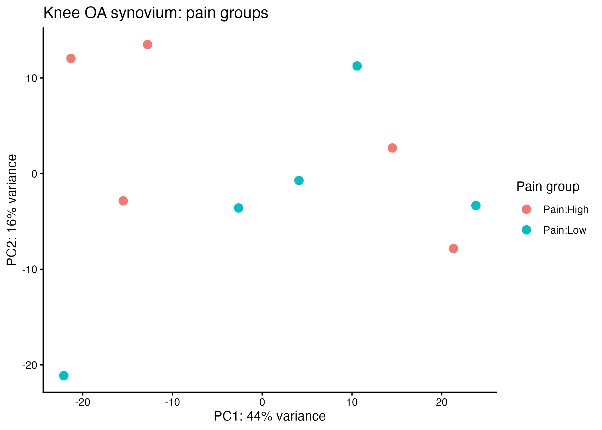
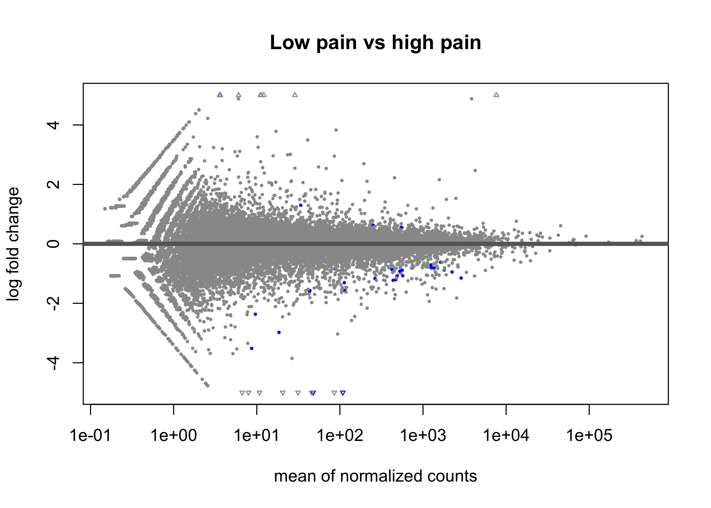
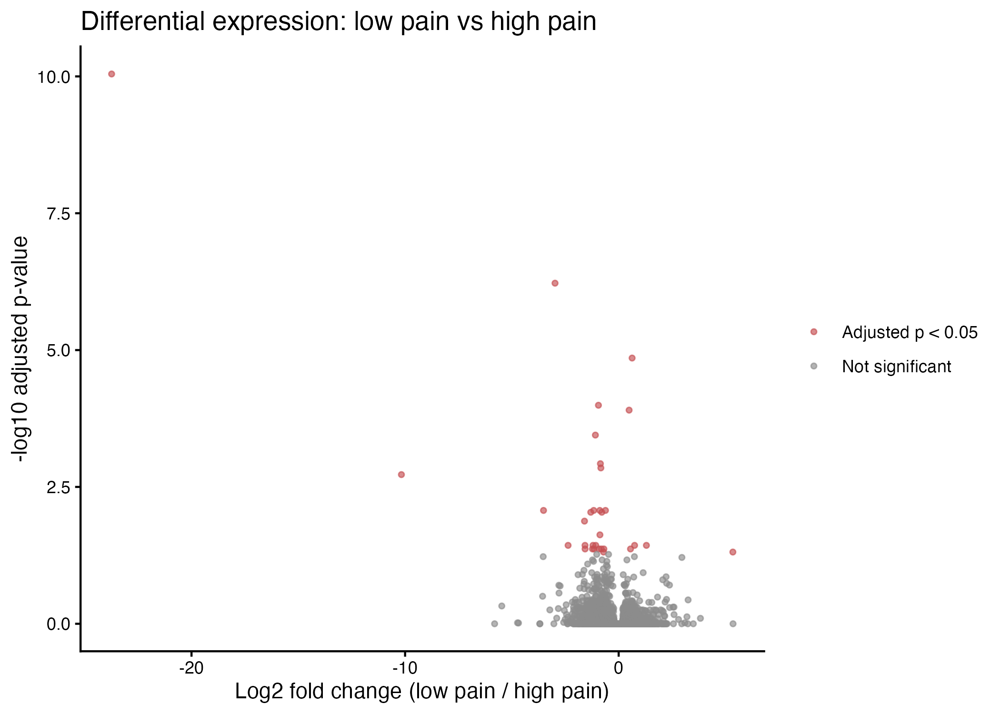
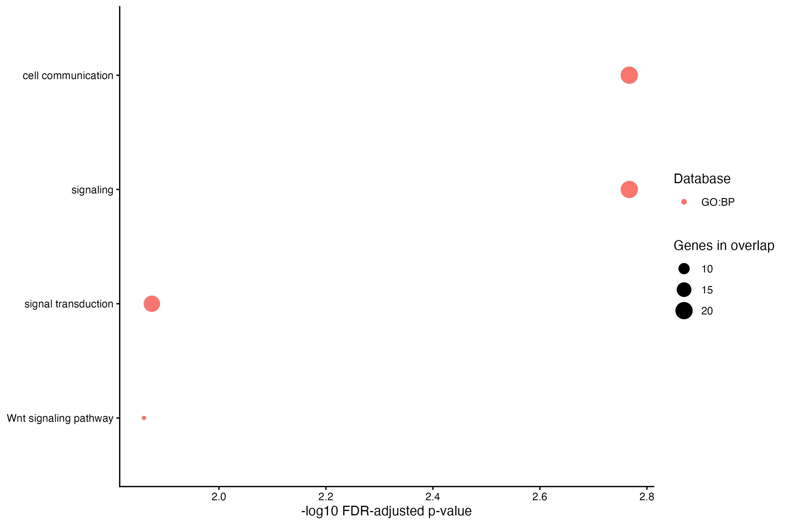

# RNA-seq analysis of pain in knee osteoarthritis

This project analyzes bulk RNA-seq from knee synovium in people with osteoarthritis, comparing **high-pain and low-pain groups**. It is not an osteoarthritis-versus-healthy comparison.

The public study has 10 participants: five per pain group. The data are from [NCBI BioProject PRJNA389258](https://www.ncbi.nlm.nih.gov/bioproject/PRJNA389258) and [GEO GSE99662](https://www.ncbi.nlm.nih.gov/geo/query/acc.cgi?acc=GSE99662). The original study is [Bratus-Neuenschwander et al. (2018)](https://pubmed.ncbi.nlm.nih.gov/29973527/).

## What the analysis does

- Checks the count matrix and matches the 10 samples to their high- or low-pain labels.
- Fits a DESeq2 model with an explicit **low pain vs high pain** contrast.
- Filters genes with total counts of 1 or less, then generates a PCA, MA plot, volcano plot, and full differential-expression table.
- Uses Benjamini–Hochberg adjusted p-values; positive log2 fold changes indicate higher expression in the low-pain group.
- Runs GO Biological Process and Reactome over-representation analysis on significant genes, using the tested genes as the background and FDR correction.

The GEO file is a gene-level processed count matrix with fractional expected counts. The study record does not provide transcript-level quantifications or sample-specific effective lengths, so `tximport` cannot be applied to the available file. DESeq2 requires integer counts; this workflow rounds the expected counts to the nearest integer. Results should be treated as exploratory.

## Results from the supplied files

The current run retained **29,912 genes** after low-count filtering; **29,838** had a non-missing test p-value. It found **32 genes with adjusted p-value < 0.05**: 6 had higher expression in the low-pain group and 26 had higher expression in the high-pain group. Truncating fractional values instead of rounding produced 30 significant genes, so the exact count depends slightly on count conversion. Top results included `RGS10`, `SFRP1`, `PLEKHO1`, and `CPE`. These are exploratory findings from five samples per group, not validated biomarkers.

The PCA plot shows the distribution of the ten samples by pain group. The MA and volcano plots summarize the gene-level comparison.

### PCA by pain group



### MA plot



### Volcano plot



### Pathway enrichment

The g:Profiler query returned four significant GO Biological Process terms after FDR correction: **cell communication**, **signaling**, **signal transduction**, and **Wnt signaling pathway**. No Reactome terms passed the threshold. The GO terms overlap and are broad; treat them as follow-up leads rather than evidence of a confirmed mechanism. The query used the 32 significant genes and 29,838 genes with test p-values as the custom background.



## Run it

Use Python 3, R, `DESeq2`, `ggplot2`, `httr2`, and `jsonlite`. Download the GEO count matrix as described in [data/README.md](data/README.md), then run:

```bash
python3 prepare_geo_counts.py
Rscript analysis.R
Rscript pathway_analysis.R
```

The scripts write the differential-expression table and plots under `results/`, plus pathway results under `results/pathways/`. The pathway script reuses its saved g:Profiler response; set `REFRESH_GPROFILER=1` to query the current annotation release. To build the HTML report in an R setup with Pandoc available, run:

```r
rmarkdown::render("analysis.Rmd")
```

## Files

- `analysis.R` — analysis workflow.
- `analysis.Rmd` — report with methods, results, and figures.
- `prepare_geo_counts.py` — extracts the 10 mRNA samples from the GEO processed matrix.
- `pathway_analysis.R` — GO Biological Process and Reactome enrichment using the tested-gene background.
- `data/README.md` — input formats and study links.
- `results/` — differential-expression table, rounding sensitivity, pathway table, figures, and the saved g:Profiler response.

The count matrix and full participant metadata are excluded from Git. Local input copies are ignored by `.gitignore`.
