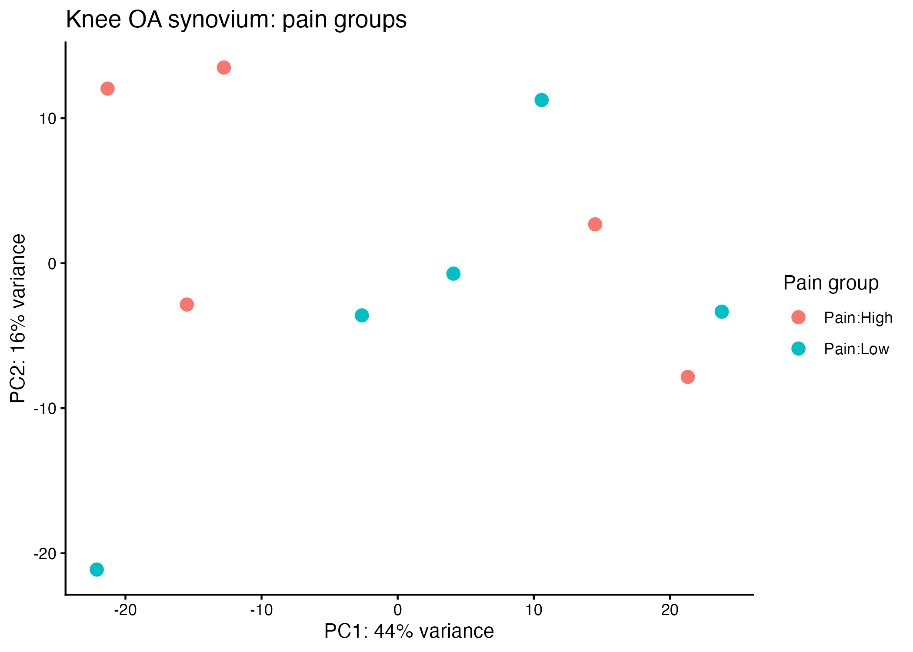
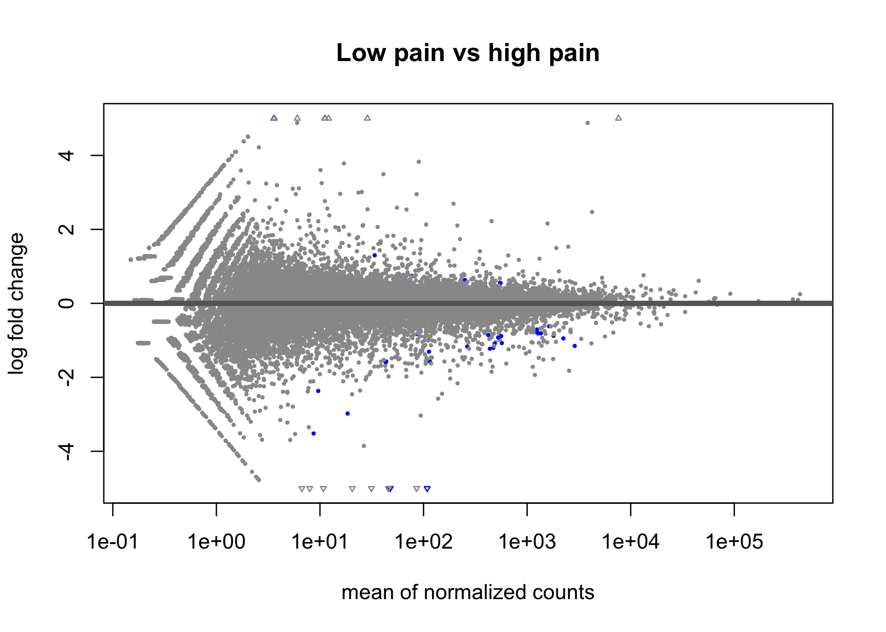
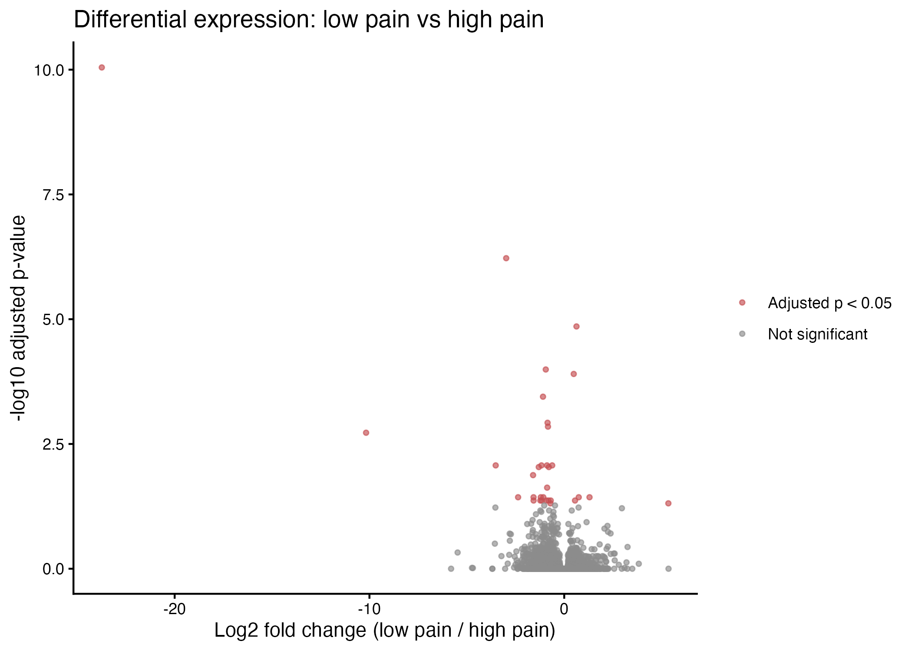
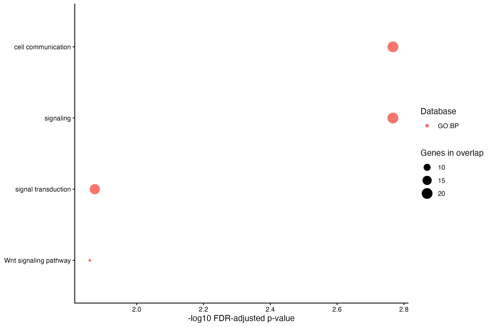

This report compares high-pain and low-pain groups in a public bulk RNA-seq study of knee osteoarthritis synovium. It does not compare osteoarthritis with healthy tissue. The study has five samples per pain group. See `data/README.md` for the data source and input details.

The gene-level matrix contains fractional RSEM expected counts. The analysis rounds these values to the nearest integer for DESeq2. This is an approximation because the transcript-level quantifications and effective lengths needed for a `tximport` workflow are not supplied.

## Run the analysis

Run `Rscript analysis.R` from the project folder, or knit this report. The workflow checks the input files, fits the explicit low-pain-versus-high-pain contrast, and writes results to `results/`. Positive log2 fold changes mean higher expression in the low-pain group.

```{r analysis, echo=TRUE, message=FALSE, warning=FALSE}
source("analysis.R")
source("pathway_analysis.R")
```

## Results

```{r summary}
cat(readLines(file.path("results", "analysis_summary.txt")), sep = "\n")
```

The results below are exploratory because the study has five samples in each group and the supplied expected counts are rounded for DESeq2.

### Principal component analysis

```{r pca, echo=FALSE, out.width="90%"}

```

### Differential expression

```{r ma, echo=FALSE, out.width="90%"}

```

```{r volcano, echo=FALSE, out.width="90%"}

```

### Pathway enrichment

```{r pathways, echo=FALSE, out.width="90%"}

```

The complete gene-level results are in `results/differential_expression.csv`. The pathway analysis table is in `results/pathways/go_reactome_enrichment.csv`.
